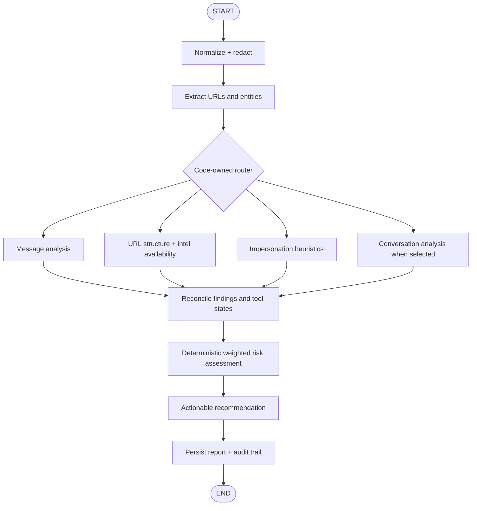

# Agent workflow

Every run has the shared `AgentResult` contract and one explicit status: `completed`, `skipped`, `failed`, or `timed_out`. Verification levels are `verified`, `heuristic`, or `llm_inferred`. External APIs have bounded timeouts/retries. Public UI output contains findings and evidence, never private model reasoning.

## Score contract

The score is a deterministic weighted indicator score from 0 to 100. Levels are 0–24 Low, 25–49 Moderate, 50–74 High, and 75–100 Critical. The score is not a probability. `model_confidence`, `evidence_strength`, and `data_availability` are separate report fields. When no calibrated classifier is available, model confidence is `not_available`.
