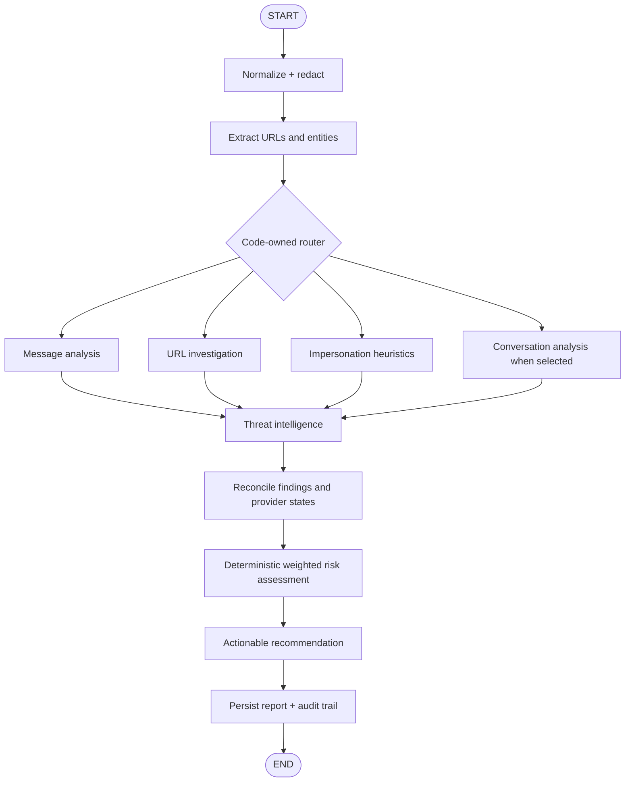

# Agent workflow

The seven requested agents are distinct graph nodes: Message, URL, Impersonation, Threat Intelligence, Conversation, Risk, and Recommendation. Threat Intelligence runs after URL analysis and calls the scanner's separate /reputation endpoint, which revalidates the public origin before querying providers.

Every agent run uses the shared AgentResult contract: status is completed, skipped, failed, or timed_out, with duration_ms, tools_used, and error. Provider results have their own status and may be unavailable; the agent run maps those outcomes into the four-state execution contract. Verification levels are verified, heuristic, or llm_inferred. Evidence strength counts verified and heuristic findings only. External APIs have bounded timeouts/retries. Public UI output contains findings and evidence, never private model reasoning.

The router is deterministic code and does not accept routing or tool choices from submitted text. The LLM explanation receives redacted text and cannot change routing, findings, or scores; provider setup and call failures leave the deterministic report available.

## Score contract

The score is a deterministic weighted indicator score from 0 to 100. Levels are 0–24 Low, 25–49 Moderate, 50–74 High, and 75–100 Critical. The score is not a probability. model_confidence, evidence_strength, and data_availability are separate report fields. When no calibrated classifier is available, model confidence is not_available.