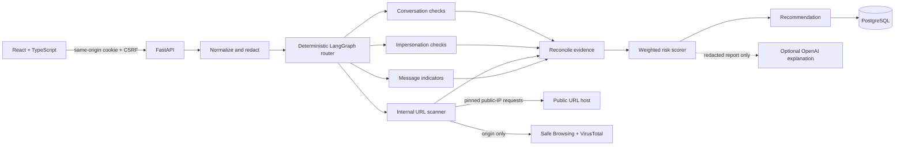

# System architecture

## Boundaries and trust

The browser submits validated input to the FastAPI service. Text is normalized and sensitive values are redacted before persistence or model use. Input content is untrusted data and cannot pick tools or alter workflow routing. The deterministic rule engine classifies indicators and calculates the risk score. An optional language model may produce a short explanation from redacted text and the already-computed report; that explanation is `llm_inferred`, never evidence.

URL inspection runs in a separate internal service. It rejects non-public DNS answers, pins each socket to a validated IP, revalidates every manual redirect, uses HEAD and a capped text-only GET fallback, and never executes JavaScript or stores/returns response bodies. Safe Browsing and VirusTotal receive only the validated URL origin. Provider errors and missing credentials remain explicit unavailable states; no match is not proof of safety.

## Components

## Data model

| Table | Purpose | Important relationships/constraints |
|---|---|---|
| `users` | Account and role | unique normalized email; `user`/`admin` role |
| `investigations` | Redacted input and final report | belongs to user; indexed by `(user_id, created_at)`, risk level, category |
| `extracted_urls` | URL observations per report | belongs to investigation; stores normalized URL and structural findings |
| `agent_runs` | Per-agent lifecycle audit | status constrained to completed/skipped/failed/timed_out; provider unavailability is stored in threat-intel results |
| `evidence` | Source-tagged findings | verification level constrained to verified/heuristic/llm_inferred |
| `threat_intel_results` | Provider response/availability record | provider, status, checked timestamp, response detail; no fabricated match |
| `scam_categories` | Extensible categories | unique code, language, display name |
| `scam_patterns` | Seeded editable indicators | category FK, pattern, language, active flag |
| `recommendations` | Advice attached to report | investigation FK, text, type |
| `feedback` | User correction signal | investigation/user FK; correct/incorrect/uncertain; separate from labels |
| `eval_labels` | Curated ground-truth labels | separate dataset/evaluation lifecycle; never inferred from feedback |
| `notifications` | Future verified-source alerts | user FK, source and delivery timestamps |
| `audit_logs` | Admin and security audit events | actor FK where applicable; redacted metadata only |

All records use UUID primary keys and UTC timestamps. Hard deletion cascades from a user through owned investigations and feedback. Sensitive credentials are never represented as fields in the schema.

## Risk register

| Risk | Mitigation/status |
|---|---|
| False reassurance when no intel match exists | Reports use `no known threat found; not verified safe`; threat provider failures are visible |
| Prompt injection in pasted content | Content is redacted and passed as data only; deterministic router owns tool selection |
| SSRF through submitted URLs | Separate service pins connections to public DNS results, blocks mixed/private answers, manually validates redirects, and caps methods/body/redirects; Docker integration remains unverified |
| Sensitive data sent to an LLM | Redaction occurs first; calls require explicit API-key configuration; no raw input is sent |
| Uncalibrated score mistaken for probability | UI calls it a risk score; confidence/data availability are separate fields |
| Missing external credentials/services | Report provider status as unavailable; never substitute sample results |
